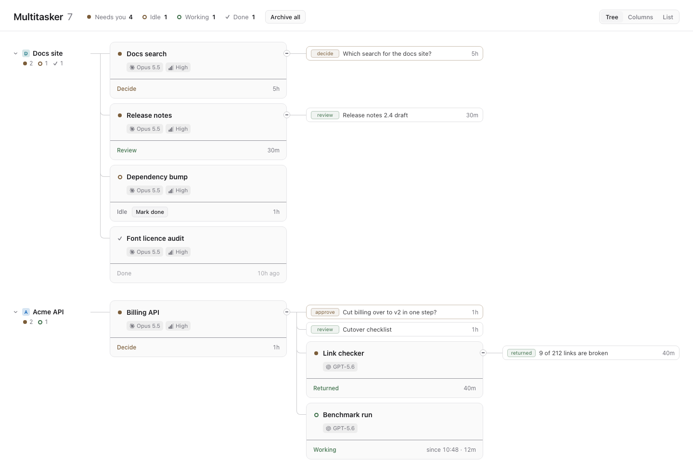
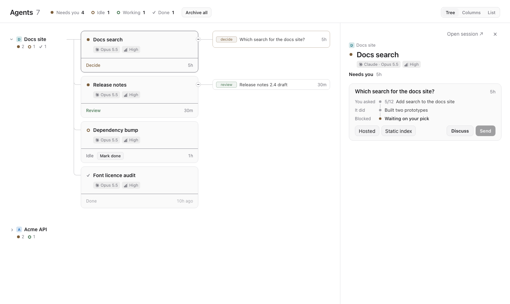
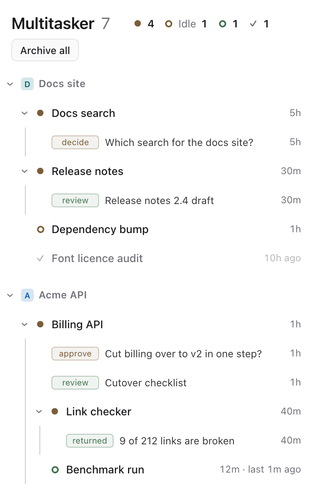

# Multitasker

Multitasker is a [Paseo](https://paseo.sh) plugin that gives you one queue for what needs you next across all your agent sessions.
Agents file cards for decisions, results to look at and dispatched work that came back; you work through them from one Multitasker screen. The queue core, the CLI and the agents' MCP tools keep the name agent-queue.

https://github.com/user-attachments/assets/461ee702-f903-4039-b3a6-44c7046afb67

## Why

When you multitask with agents, sending one off is the easy part: an idea comes up, you hand it to an agent and go back to what you were doing. The hard part comes later. Replies arrive while you are somewhere else, the same agent comes back several times with different tasks, and remembering what you asked, which agent is waiting on you and which threads are still open is left to your head.

Multitasker takes that bookkeeping off you. When an agent needs you, for a decision, a result to look at or dispatched work that came back, it adds a card to the queue itself. Every agent sits in a tree under the agent that started it, with its open cards beside it, and each card opens with what you asked, what the agent did and what now waits for you. Days later you can still see what happened, answer in place and close the thread.







## Features

- **Multitasker screen**: every agent as Needs you, Idle, Working or Done, nested under the agent that started it and grouped by workspace. Three views: Tree, Columns, List.
- **Cards**: one card holds one thing, an ask (with options and a recommendation), a result or a receipt. Each opens with three steps: what you asked, what the session did, what now waits for you.
- **Answer in place**: pick an option and send it into the session, reply in your own words, mark a result as seen, or open the session.
- **Host cards**: permission requests, failed turns and finished `paseo run` children are recorded without the agent doing anything.
- **Closed list and Reopen**: closed cards stay under their agent; reopen one that was closed by mistake.
- **Keyboard**: `j`/`k` step through cards, `1`-`9` pick an option, `Enter` sends, `e` marks seen, `o` opens the session, `Esc` goes back.
- **Phone friendly**: the same screen works on a narrow viewport.

## Install

Needs Paseo 0.15.3 or newer, and Node.js 22.13 or newer on the daemon host (23.4 or newer on Node 23) for the built-in `node:sqlite`. `bin/agent-queue` runs its TypeScript source directly, so the CLI needs a Node with type stripping on by default (22.18 or newer, or 23.6 or newer). npm must be on the daemon's command path.

Turn on plugins in Paseo first: Settings, Plugins, Enable plugins, or `paseo daemon config set pluginsEnabled true`. It takes effect without a restart. While that switch is off a plugin stays disabled, and `paseo plugin enable multitasker` has no effect.

```sh
paseo plugin install git:https://github.com/SizhuangHe/paseo-multitasker.git:paseo-plugin
paseo plugin ls            # multitasker should be running
```

Paseo clones the repository and runs the manifest's build step, `npm ci --omit=dev --ignore-scripts`, in `paseo-plugin/`. It links `core/` from the same checkout and downloads no packages from the npm registry.

## What agents get

Every interactive session gets an MCP server with three tools:

| Tool | Use |
|---|---|
| `queue_add` | File one card: an `ask`, a `result` or a `receipt`, with a `topic` and a three-step `timeline`. Filing the same line again updates the card; `replaces` swaps one. |
| `queue_track` | Register dispatched work; its result comes back as a card. |
| `queue_resolve` | Close cards that are handled. |

Depending on its permission mode, an agent's provider may ask before each of these tools runs. You can allow them ahead of time, for example by adding `mcp__agent-queue__queue_add`, `mcp__agent-queue__queue_track` and `mcp__agent-queue__queue_resolve` to Claude Code's permission allow list.

The server also sends a short filing guide (`paseo-plugin/server/guide.ts`) as its `instructions`: when to file, how to write for someone who forgot the context, and how to resolve. Cards are written in the language the agent uses with you.

## CLI

`bin/agent-queue` reads and writes the same queue from a terminal: `add`, `resolve`, `track`, `list`, `show`, `stats` and more. Run `bin/agent-queue --help`.

## Data

Cards live in a local SQLite file, `~/.local/share/agent-queue/queue.db`. Set `AGENT_QUEUE_DB` (or pass `--db`) to use another file.

## License

MIT, see [LICENSE](LICENSE).
